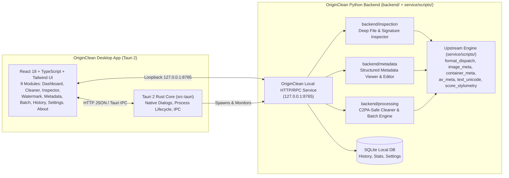

# OriginClean — Phase 1 Repository Audit & Architecture Report

**Project:** OriginClean  
**Tagline:** Clean Your Files. Preserve Their Origin.  
**Developer & Publisher:** Muhammad Lutfi Muzaki  
**Application Identifier:** `com.muhammadlutfimuzaki.originclean`  
**Reference Upstream Repository:** `https://github.com/guillaumemeyer/watermarks-remover.git` (MIT License)

---

## 1. Existing Functionality Audit

The upstream repository (`watermarks-remover`) is a hardened, stdlib-first Python toolkit and HTTP microservice located primarily in `service/scripts/` with comprehensive test coverage in `tests/`.

### 1.1 Core Processing Scripts (`service/scripts/`)
| Module | Responsibility | Supported Formats / Scope |
|---|---|---|
| `format_dispatch.py` | Format classification by extension and magic-byte header/central-directory sniffing (`classify`, `classify_bytes`). | Text (50+ extensions), Image (11), Container (14), Audio/Video (7). |
| `text_unicode.py` | **Layer A** deterministic text inspection (`inspect_text`) and cleaning (`clean_text`). | Zero-width characters, Bidi controls, variation selectors (`FE00..FE0F`, `E0100..E01EF`), Unicode noncharacters, space homoglyphs, and optional Latin confusables / NFKC normalization. |
| `score_stylometry.py` | Heuristic statistical analysis (`score_text_stylometry`) measuring burstiness, em-dash density, trigrams, and AI vocabulary signals. | Plain text and markup bodies. |
| `text_detectors.py` / `detect_gumbel.py` | Scheme-specific statistical watermark detection (`run_all_text_detectors`). | Gumbel/Aaronson (`detect_gumbel.py`), SynthID Text, MarkLLM, GPTZero/Originality/Sapling (when configured). |
| `rewrite_text.py` / `humanize_pass.py` | **Layer B** text paraphrasing/rewriting (`apply_strategy`). | Requires external/local LLM endpoint (`ollama` or `openai-compatible`) or `transformers` MLM. |
| `image_meta.py` | Raster image inspection (`inspect_image`) and metadata/chunk stripping (`clean_image`). | **PNG** (`eXIf`, `caBX`, `c2*`, `tEXt`, `zTXt`, `iTXt`), **JPEG** (`APP1` EXIF/XMP, `APP11` JUMBF/C2PA, `APP13` IPTC, `COM`), **WebP** (`EXIF`, `XMP `, `ICCP`, `C2PA`), **AVIF/HEIC** (ISOBMFF `jumb`/`c2pa`/`uuid`/`meta`), **BMP**, **GIF** (XMP/Comment extensions), **TIFF** (Classic & BigTIFF IFD tags: EXIF, GPS, XMP, IPTC, C2PA). Optional `exiftool`/`c2patool` probes and optional `CtrlRegen`/`MarkDiffusion` pixel purification. |
| `container_meta.py` | Document & container inspection (`inspect_container`) and cleaning (`clean_container`). | **PDF** (XMP, Info dict, `/PieceInfo`, C2PA, embedded images & file attachments with optional `qpdf`/`ghostscript`), **DOCX / XLSX / PPTX** (OOXML core/app/custom properties, customXml, C2PA manifest parts, embedded media, Layer A body text), **ODT** (`meta.xml`, RDF, embedded media, Layer A body), **EPUB** (OPF package metadata, XHTML meta/JSON-LD, embedded media), **SVG** (XML metadata/RDF/XMP), **HTML** (`<meta>` generator/AI tags, JSON-LD), **Markdown** (YAML/TOML frontmatter), **LaTeX** (`\pdfinfo`, `\hypersetup`, provenance comments). |
| `av_meta.py` | Audio and video container metadata inspection (`inspect_av`) and stripping (`clean_av`). | **MP4 / MOV / M4A / M4V** (ISOBMFF top-level C2PA/UUID boxes + `moov/udta` atoms), **WAV** (RIFF `LIST/INFO`, `id3 `, `c2pa`, `iXML`, `axml`), **MP3** (ID3v2.3/v2.4 `TXXX`, `COMM`, `PRIV`, `GEOB`, `TENC`, `TSSE`), **FLAC** (ID3v2 wrapper, Vorbis comments, `APPLICATION` blocks). |
| `clean_audio.py` / `clean_video.py` | Optional FFmpeg-based media stream purification (`audio_purify`, `video_purify`). | Audio pitch/tempo micro-shift + AAC re-encode (`ffmpeg`); Video per-frame pixel purification when `ctrlregen`/`diffusion` backend is installed. |
| `server.py` | Stdlib `ThreadingHTTPServer` JSON API. | `GET /health`, `GET /capabilities`, `GET /openapi.json`, `POST /inspect`, `POST /detect`, `POST /clean`, `POST /watermark`, and `/batch` variants. |
| `common.py` | Security & reliability primitives. | `MAX_INPUT_BYTES` (256 MiB cap), `looks_binary` guard, atomic file replacement (`safe_write_bytes`, `safe_write_text`), `.bak` creation, child-process RLIMITs. |

---

## 2. Reusable Components

1. **100% of `service/scripts/` parsers and cleaners** (`format_dispatch.py`, `image_meta.py`, `container_meta.py`, `av_meta.py`, `text_unicode.py`, `score_stylometry.py`, `text_detectors.py`, `clean_audio.py`, `clean_video.py`, `common.py`, `server.py`) can and must be reused directly without duplicating binary parsing logic.
2. **Existing test suite (`tests/`)**: All 60+ test modules and fixtures in `tests/` remain intact to guarantee zero regressions in the core engine.

---

## 3. Missing Components & Technical Gaps for OriginClean Desktop

1. **Graphical Desktop Application (Tauri 2 + React + TypeScript)**:
   - Upstream is CLI/Docker-only. Users currently need a terminal or curl/Docker setup.
2. **Local-First Text Cleaning in HTTP Server**:
   - Upstream `server.py`'s `POST /clean` enforces Layer B (`_apply_layer_b`) on plain text and fails with `400 Bad Request` if no LLM rewrite backend is configured, whereas `clean_file.py` cleans Layer A Unicode locally without requiring an LLM. OriginClean must support local-first Layer A text cleaning out of the box while keeping Layer B optional.
3. **C2PA & Authenticity Provenance Preservation Guard**:
   - Upstream strips C2PA manifests by default during cleaning. OriginClean's security & ethics policy requires preserving C2PA and authenticity provenance by default and requiring explicit user authorization before removing provenance records.
4. **Structured Metadata Inspector, Selective Remover & Editor (`backend/metadata/`)**:
   - Upstream inspects for AI/C2PA markers and strips either AI-only or all metadata, but does not expose a structured key-value dictionary of general metadata fields (EXIF camera/GPS/dimensions, PDF/DOCX/XLSX/PPTX/ODT/EPUB author/title/subject/creator, ID3/WAV/FLAC/MP4 tags) or allow selective field preservation and editing.
5. **Local Path Processing & Persistent SQLite Storage (`backend/service/`)**:
   - Passing large video/image files as Base64 over JSON inflates memory by 33%. Adding local path endpoints alongside Base64 endpoints allows zero-copy local file inspection/cleaning, persistent SQLite Processing History, real Dashboard telemetry, and persistent user Settings.

---

## 4. Technical Limitations (Documented Honestly)

- **Pixel/Statistical Image Watermarks (SynthID, Tree-Ring, Stable Signature)**: Metadata stripping (`image_meta.py`) removes container chunks (C2PA, EXIF, XMP, IPTC) losslessly without altering pixels. Removing pixel-embedded watermarks requires external PyTorch GPU weights (`CtrlRegen` or `MarkDiffusion`) and is lossy. OriginClean clearly distinguishes container metadata removal from pixel purification and reports whether optional pixel backends are installed.
- **PDF Structural Limitations**: Pure-Python PDF cleaning scrubs XMP packets, `/Info` dictionaries, `/PieceInfo`, and embedded attachments/images. Full linear structural cross-reference rewriting is enhanced when optional `qpdf` and `ghostscript` binaries are installed on `PATH`.
- **Cryptographic Signatures & C2PA**: Editing any byte of a C2PA-signed asset invalidates its cryptographic signature. OriginClean warns the user before modifying any file containing C2PA manifests and defaults to preserving C2PA boxes/chunks unless explicitly overridden.
- **Audio/Video Stream Watermarks**: Container cleaning (`av_meta.py`) is lossless and strips metadata boxes/frames (`moov/udta`, `ID3v2`, `LIST/INFO`, Vorbis comments). Acoustic waveform watermark removal requires `ffmpeg` on `PATH` and performs a lossy re-encode.

---

## 5. Integration Strategy & Proposed OriginClean Architecture

1. **Zero Duplication of Upstream Engine**: `backend/` adds `service/scripts/` to `sys.path` and calls `classify`, `inspect_image`, `clean_image`, `inspect_container`, `clean_container`, `inspect_av`, `clean_av`, `inspect_text`, `clean_text`, `score_stylometry`, and `capabilities` directly.
2. **Backward-Compatible HTTP Server**: `backend/service/app_server.py` subclasses the upstream `server.py` `Handler` so all existing `/health`, `/capabilities`, `/openapi.json`, `/inspect`, `/detect`, `/clean`, `/watermark`, and `/*/batch` endpoints remain 100% compatible, while adding `/api/v1/*` endpoints for desktop features (metadata editing, C2PA-preserving clean, local file paths, batch queue, SQLite history, dashboard stats, and settings).
3. **Cross-Platform Packaging**: Tauri 2 (`src-tauri/`) compiles a lightweight native binary for Windows (`.exe`, `.msi`), macOS (`x86_64` & `aarch64` `.dmg`, `.app`), and Linux (`.AppImage`, `.deb`, `.rpm`), automated via GitHub Actions.

